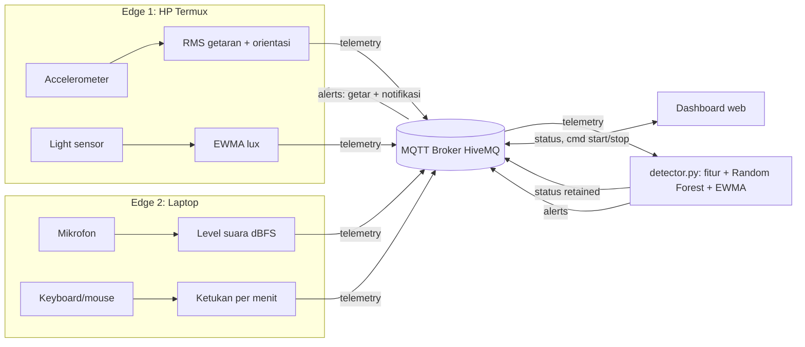
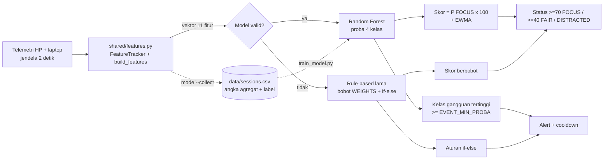

# Arsitektur FocusNest

Empat kotak cara kerja IoT (sesuai materi kuliah):

| Kotak | Di proyek ini |
|---|---|
| Sensor + Edge | **Edge 1** HP Android (accelerometer + light, Python di Termux) dan **Edge 2** laptop (mikrofon + aktivitas keyboard/mouse) |
| Jaringan | WiFi / hotspot yang sama |
| Cloud | Broker MQTT publik HiveMQ (`broker.hivemq.com`, TLS port 8883) |
| Dashboard | Web di laptop (`detector.py` menyajikan `dashboard/index.html`), bisa dibuka dari HP di jaringan yang sama |



## Topic MQTT

Semua topic diawali `focusnest/<PROJECT_ID>/`.

| Topic | Arah | Isi |
|---|---|---|
| `edge/edge1/telemetry` | HP -> cloud | `motion_rms`, `orientation`, `lux` |
| `edge/edge2/telemetry` | laptop -> cloud | `noise_dbfs`, `keys_per_min`, `mouse_moves` |
| `edge/<id>/online` | edge -> cloud (retained, LWT) | `1` / `0` |
| `status` | detector -> HP + dashboard (retained) | state, skor, skor per sensor, statistik sesi, `model` (`source` = `ml`/`rule`, `proba` 4 kelas) |
| `alerts` | detector -> HP | jenis dan pesan gangguan |
| `cmd` | dashboard -> detector | `{"action":"start"}` / `{"action":"stop"}` |

Contoh payload `edge1/telemetry`:

```json
{"device_id":"edge1","sequence":42,"sent_at_ms":1793275032000,"motion_rms":0.031,"orientation":"face_down","lux":null,"samples":20}
```

## Pengolahan data dan algoritma

| Lokasi | Pengolahan | Rumus |
|---|---|---|
| HP | 1. RMS getaran | `m = sqrt(x²+y²+z²) - 9,81`; `rms = sqrt(mean(m²))` |
| HP | 2. Klasifikasi orientasi | rata-rata z <= -6 telungkup, >= 6 telentang |
| HP | 3. Penghalusan cahaya | `lux_s = 0,3 lux + 0,7 lux_s_lama` (EWMA) |
| Laptop | 4. Level suara | `dBFS = 20 log10(rms audio)` |
| Laptop | 5. Laju mengetik | ketukan per jendela x 60 / panjang jendela |
| Detector | Ekstraksi fitur | 11 fitur numerik per jendela (`shared/features.py`), termasuk baseline suara, z-score EWMA, `move_streak` |
| Detector | **Klasifikasi Random Forest** | probabilitas `FOCUS`, `PHONE_DISTRACTION`, `NOISE_DISTRACTION`, `DARK_ROOM`; `skor = P(FOCUS) x 100` (EWMA `SCORE_SMOOTH_ALPHA`) |
| Detector | Event/alert | kelas gangguan dengan probabilitas tertinggi (>= `EVENT_MIN_PROBA`), cooldown `ALERT_COOLDOWN_SEC` |
| Detector | *Fallback* rule-based (lama) | `skor = 0,30 suara + 0,20 cahaya + 0,35 HP + 0,15 aktivitas`; lonjakan jika `z > 3` dan `>= 10 dB`; HP bergerak >= 2 jendela dan laptop sepi -> `PHONE_DISTRACTION` |

Sensor cahaya ada di depan HP, jadi saat HP telungkup nilainya tidak valid dan diabaikan.

## Alur data -> fitur -> model -> skor -> alert



`shared/features.py` adalah satu-satunya tempat fitur dibangun. Fungsi `build_features()` dipakai bersama oleh mode collect (rekaman data), generator data sintetis, dan inferensi, sehingga tidak terjadi *training-serving skew*. Urutan kolom dikunci oleh `FEATURE_NAMES`.

| Fitur | Arti |
|---|---|
| `motion_rms`, `orientation` (-1/0/1) | getaran dan posisi HP |
| `lux`, `lux_valid` | cahaya; `lux = -1` dan `lux_valid = 0` bila sensor tertutup (HP telungkup), tanpa NaN |
| `noise_dbfs`, `noise_delta`, `noise_zscore` | level suara, kenaikan dari baseline ruangan, z-score lonjakan |
| `keys_per_min`, `mouse_moves`, `laptop_idle` | aktivitas laptop (hanya jumlah) |
| `move_streak` | jendela berturut-turut HP bergerak |

## Fallback otomatis ke rule-based

`FocusEngine.auto()` memakai model bila `model/focus_rf.joblib` ada dan valid. Mode **rule** dipakai otomatis (badge dashboard "Aturan", `model.source = "rule"`) bila:

- file model tidak ada atau rusak;
- `FEATURE_NAMES` / daftar kelas di metadata berbeda dari kode;
- versi scikit-learn terpasang berbeda dari versi saat training;
- scikit-learn / joblib tidak terpasang;
- model gagal saat memprediksi (dicatat satu kali di log, detector tetap berjalan);
- `USE_ML=false` atau `--no-ml`.

Logika sesi (`start_session`, `stop_session`, detik fokus, gangguan, cooldown alert) sama untuk kedua mode. Inferensi satu jendela memakan sekitar 10 ms pada laptop biasa (`n_jobs=1`), jauh di bawah jeda evaluasi 1 detik, dan MQTT berjalan di thread terpisah sehingga tidak terblokir.

## Model bawaan dan data sintetis

Model bawaan dilatih dari data simulasi (`tools/generate_synthetic_data.py`, seed tetap) dan ditandai `data_source = "synthetic"` pada metadata; dashboard menampilkan "(model awal)". Setelah dilatih ulang dengan data asli, tanda itu hilang. Batasan data sintetis dijelaskan di `docs/EVALUASI.md`.
