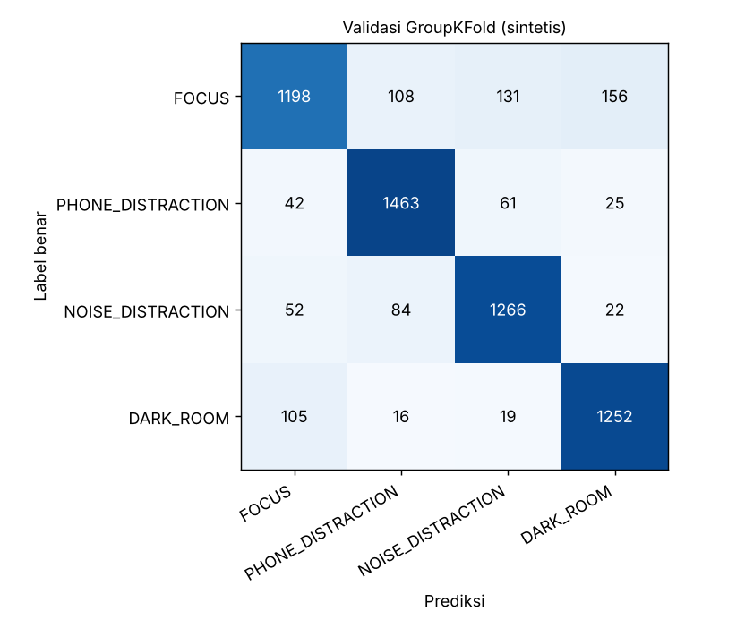
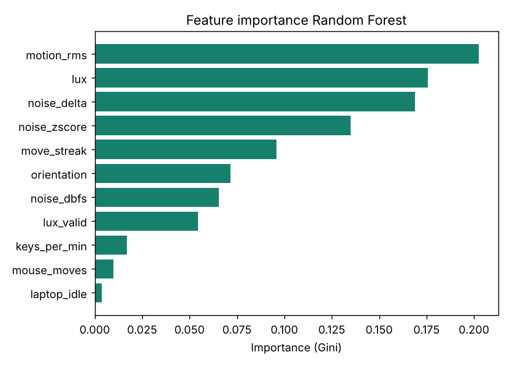

# Evaluasi Model Random Forest FocusNest

Dibuat otomatis oleh `train_model.py` pada 2026-11-05 (scikit-learn 1.9.1).

> **Peringatan:** model ini dilatih HANYA dari data sintetis (simulasi). Angka di bawah belum membuktikan performa pada sensor sungguhan.

## 1. Data latih

| Sumber | FOCUS | PHONE_DISTRACTION | NOISE_DISTRACTION | DARK_ROOM | Total |
|---|---|---|---|---|---|
| synthetic | 1593 | 1591 | 1424 | 1392 | 6000 |

Hyperparameter: `n_estimators=100`, `max_depth=8`, `class_weight=balanced`, `random_state=42`. Dipilih lewat pencarian kecil (`--search`) pada validasi silang yang sama dengan bagian 2, sehingga angka bagian 2 sedikit optimistis.

## 2. Validasi pada data sintetis (hanya sanity check, bukan bukti performa nyata)

GroupKFold 5 lipatan berdasarkan `session_id` (bukan split acak per baris). Data sintetis dibangkitkan dengan asumsi dari penulis kode, sehingga skor tinggi di sini hanya menunjukkan bahwa pipeline berjalan dan model dapat mempelajari pola yang sengaja dimasukkan ke generator.

**Accuracy: 0.863 | Macro-F1: 0.863**

| Kelas | Precision | Recall | F1 | Jumlah |
|---|---|---|---|---|
| FOCUS | 0.858 | 0.752 | 0.801 | 1593 |
| PHONE_DISTRACTION | 0.876 | 0.920 | 0.897 | 1591 |
| NOISE_DISTRACTION | 0.857 | 0.889 | 0.873 | 1424 |
| DARK_ROOM | 0.860 | 0.899 | 0.880 | 1392 |

Confusion matrix (gabungan semua lipatan):

| Benar \ Prediksi | FOCUS | PHONE_DISTRACTION | NOISE_DISTRACTION | DARK_ROOM |
|---|---|---|---|---|
| **FOCUS** | 1198 | 108 | 131 | 156 |
| **PHONE_DISTRACTION** | 42 | 1463 | 61 | 25 |
| **NOISE_DISTRACTION** | 52 | 84 | 1266 | 22 |
| **DARK_ROOM** | 105 | 16 | 19 | 1252 |



## Feature importance

| Fitur | Importance |
|---|---|
| motion_rms | 0.203 |
| lux | 0.176 |
| noise_delta | 0.169 |
| noise_zscore | 0.135 |
| move_streak | 0.096 |
| orientation | 0.071 |
| noise_dbfs | 0.065 |
| lux_valid | 0.054 |
| keys_per_min | 0.017 |
| mouse_moves | 0.010 |
| laptop_idle | 0.004 |



## Batasan data sintetis

- Distribusi sintetis ditentukan oleh penulis generator (`tools/generate_synthetic_data.py`) dari nilai tipikal proyek; bukan hasil pengukuran. Pola yang "dipelajari" model adalah pola yang kita tulis sendiri.
- Kelas dibuat saling tumpang tindih, ada kasus campuran, dan 4% label diacak, tetapi dunia nyata lebih berantakan (mikrofon, hotspot, kebiasaan orang berbeda).
- Sensor cahaya HP tertutup saat telungkup, sehingga ruangan gelap sulit dikenali pada kondisi itu (`lux_valid = 0`); generator hanya meniru sebagian kasus ini.
- Karena itu model bawaan adalah **model awal**. Untuk performa yang bisa dipertanggungjawabkan, rekam data asli (`detector.py --collect`), latih ulang, dan uji dengan `--test-data` pada sesi yang berbeda.

## Cara mereproduksi

```bash
python tools/generate_synthetic_data.py
python train_model.py --data data/synthetic.csv --search
```
